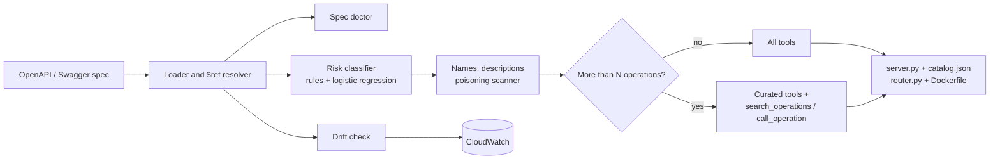

# MCPForge: ML-assisted MCP server generator

MCPForge turns an OpenAPI 3.x or Swagger 2.0 specification into a ready-to-run
[Model Context Protocol](https://modelcontextprotocol.io) server. Unlike a plain
one-endpoint-one-tool converter, it treats the spec as data and runs it through a
small ML pipeline before writing any code:

* **Spec doctor** finds the defects that usually break generated servers (relative or missing base URLs, missing security schemes, missing operation ids, undocumented operations) and scores spec health.
* **Risk classifier** (scikit-learn, trained on 8,218 real API operations) labels every operation `read`, `write` or `destructive`. The label drives MCP tool annotations (`readOnlyHint`, `destructiveHint`, `idempotentHint`) and a runtime safety policy.
* **Curated mode** exposes at most N direct tools (default 25) and puts the rest behind `search_operations` and `call_operation`, so a 800-endpoint API no longer floods the model's context.
* **Tool router** (BM25 by default, Amazon Titan Text Embeddings V2 on Bedrock optionally) answers `search_operations`.
* **Tool-poisoning scanner** withholds descriptions that contain hidden instructions, secret-file requests, exfiltration phrasing or invisible Unicode.
* **Drift monitor** compares each new spec with training-time statistics and publishes metrics to Amazon CloudWatch.

The ML side is built to run on AWS: SageMaker script-mode training, Automatic Model
Tuning, a SageMaker Pipeline with a quality gate and Model Registry, a serverless
inference endpoint, and a Lambda + API Gateway generator service defined in SAM.



## Results

| Measurement | Result |
|---|---|
| Training corpus | 8,218 operations, 273 APIs, 35 providers (APIs.guru directory) |
| Risk classifier, held-out gold set (183 ops, 8 unseen providers) | accuracy 0.951, macro F1 0.951 |
| Same set, HTTP-method rule baseline | accuracy 0.792, macro F1 0.795 |
| Destructive precision / recall | 1.00 / 0.887 |
| Tool-list size, curated vs all tools (GitHub, 811 ops) | 1,079,726 to 37,106 characters (96.6% smaller) |
| Tool-list size, curated vs all tools (Stripe, 448 ops) | 92.2% smaller |
| Tool-list size, curated vs all tools (Slack, 174 ops) | 86.0% smaller |
| Router, 65 natural-language requests over GitHub, Stripe, Slack | Recall@5 0.723, MRR 0.565 (TF-IDF baseline 0.662 / 0.540) |
| Poisoning scanner, 20 attack descriptions vs 2,173 real operations | 20/20 detected, 2 false positives (0.09%) at medium severity |
| Test suite (10 unit, 3 end-to-end: generated server driven by an MCP client over stdio) | 13 passing |

Details and scripts: `ml/reports/` and the evaluation section below.

## Quick start

```bash
git clone https://github.com/mehratanveer6/mcpservergenerator
cd mcpservergenerator
pip install -e ".[runtime]"

mcpforge doctor examples/petclinic.yaml
mcpforge classify examples/petclinic.yaml
mcpforge generate examples/petclinic.yaml -o out/petclinic
cd out/petclinic && pip install -e . && python server.py      # stdio
```

A generated example is committed in `examples/generated_petclinic/`.

Point any MCP client at the generated server:

```json
{
  "mcpServers": {
    "pet_clinic": {
      "command": "python",
      "args": ["/abs/path/out/petclinic/server.py"],
      "env": {"API_KEY": "...", "MCPFORGE_POLICY": "read_write"}
    }
  }
}
```

### CLI

| Command | Purpose |
|---|---|
| `mcpforge generate SPEC -o DIR` | generate a server project (`--mode auto/all/curated`, `--max-tools 25`, `--policy read_only/read_write/full`) |
| `mcpforge generate ... --enhance bedrock` | rewrite weak descriptions with a Bedrock model (rewrites must pass the poisoning scanner) |
| `mcpforge generate ... --embeddings bedrock` | precompute Titan embeddings so the router can run in `embedding` mode |
| `mcpforge generate ... --publish-metrics` | send health, risk and drift metrics to CloudWatch |
| `mcpforge doctor SPEC [--json]` | spec health report |
| `mcpforge classify SPEC` | risk label and confidence per operation |
| `mcpforge scan SPEC` | tool-poisoning scan |

### What a generated project contains

| File | Content |
|---|---|
| `server.py` | MCP server (official Python SDK 2.x): one typed async function per direct tool, annotations, policy enforcement, auth, response truncation |
| `catalog.json` | every operation with parameters, risk label and description (used by `call_operation`) |
| `router.py` | dependency-free BM25 / embedding router |
| `README.md`, `pyproject.toml`, `.env.example`, `Dockerfile` | run and deploy (stdio or streamable HTTP) |
| `mcpforge_report.json` | doctor checks, risk counts, low-confidence labels, drift metrics |

Runtime policy (`MCPFORGE_POLICY`): `read_only` registers only read tools, `read_write`
(default) adds write tools, `full` also enables destructive tools.

## Machine learning pipeline

| Stage | Implementation |
|---|---|
| Data collection | `ml/build_dataset.py` parses the newest version of each API in the APIs.guru openapi-directory (35 providers) |
| Labelling | weak supervision with transparent labelling functions (`mcpforge/rules.py`); gold set of 183 operations reviewed against `ml/LABELING_GUIDE.md` |
| Features | `mcpforge/features.py`: TF-IDF on identifiers, summary, description and path; method-prefixed verb tokens; lexicon flags; structural counts. Shared by training and inference to avoid skew |
| Model selection | `ml/experiment.py`: provider-grouped 5-fold CV grid search (20 candidates), comparison with linear SVM, complement naive Bayes and random forest |
| Final classifier | hybrid: high-precision rules, model for the ambiguous bucket, destructive safety threshold, DELETE floor |
| Training on AWS | `ml/train.py` (SageMaker script mode), `aws/sagemaker_train_deploy.py` (Spot training, Bayesian tuning, serverless endpoint) |
| Orchestration | `aws/sagemaker_pipeline.py`: train, evaluate on gold set, quality gate (macro F1 >= 0.90), register in Model Registry |
| Serving | `ml/inference.py` (`model_fn`, `input_fn`, `predict_fn`, `output_fn`) |
| Monitoring | `mcpforge/drift.py` (PSI, OOV rate, confidence), CloudWatch metrics and alarms in `aws/template.yaml` |

Reproduce the numbers:

```bash
pip install -e ".[dev]"
python ml/build_dataset.py --specs /path/to/openapi-directory/APIs   # optional, dataset is committed
python ml/experiment.py
python ml/router_eval.py --specs github.yaml stripe.yaml slack.yaml
python ml/poisoning_eval.py github.yaml stripe.yaml slack.yaml
pytest -q
```

## AWS deployment

```bash
# 1. train, tune and deploy the classifier (needs a SageMaker execution role)
pip install -r aws/requirements.txt
python aws/sagemaker_train_deploy.py --role arn:aws:iam::<account>:role/<SageMakerRole>

# 2. CI/CD style pipeline with a quality gate
python aws/sagemaker_pipeline.py --role arn:aws:iam::<account>:role/<SageMakerRole> --run

# 3. generator as a service: Lambda (container) + HTTP API (IAM auth) + S3 + alarms
sam build -t aws/template.yaml && sam deploy --guided
```

Generated servers ship with a Dockerfile for the streamable HTTP transport and can run on
ECS Fargate or any container platform. The bundled `risk_model.joblib` was trained with
scikit-learn 1.9; SageMaker jobs retrain inside the managed scikit-learn container.

## Mapping to the AWS Certified Machine Learning Engineer - Associate domains

| Exam domain | Where it appears |
|---|---|
| 1. Data preparation for ML | corpus ingestion, normalisation, `$ref` resolution, weak labelling, provider-grouped split, data-quality checks (spec doctor) |
| 2. ML model development | feature engineering, model comparison, grouped cross-validation, hyperparameter tuning, class-imbalance handling, cost-sensitive threshold |
| 3. Deployment and orchestration | SageMaker script mode, Spot training, AMT, Pipelines with quality gate, Model Registry, serverless endpoint, Lambda container, SAM |
| 4. Monitoring, maintenance and security | drift metrics, CloudWatch alarms, least-privilege IAM, S3 encryption, tool-poisoning defence, destructive-action policy |

## Project layout

```
mcpforge/            generator package (loader, doctor, rules, features, risk, curate, describe,
                     poisoning, drift, generator, cli, templates/, runtime/router.py, aws/)
ml/                  dataset, training, experiment, evaluation and benchmark scripts, reports/
aws/                 SageMaker training/tuning/deploy, pipeline, SAM template, Lambda Dockerfile
examples/            sample specs and a generated server
tests/               unit tests and end-to-end tests against a mock API
```

## Limitations

* Weak labels inherit the blind spots of the rules (for example document-fetch POST endpoints are labelled `write`); the gold set is small (183 operations).
* Router recall on GitHub (Recall@5 0.60) is lower than on Stripe and Slack; the Bedrock embedding back end is implemented but was not benchmarked here.
* Remote `$ref`s (other files or URLs) are not resolved; they become generic objects.
* OAuth flows are reduced to a bearer token supplied through `API_TOKEN`.

## License

MIT
